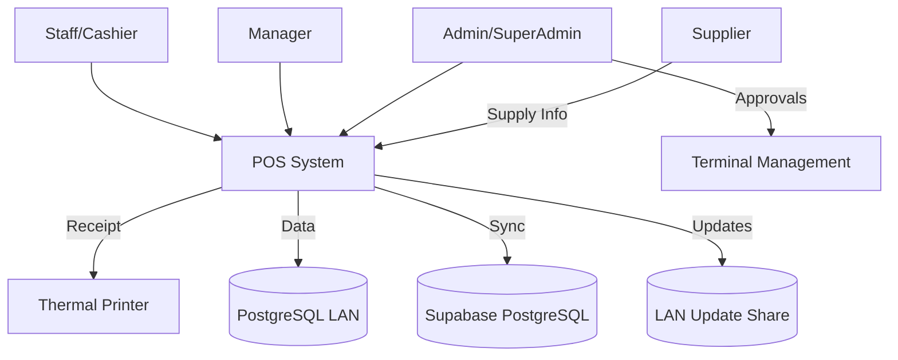
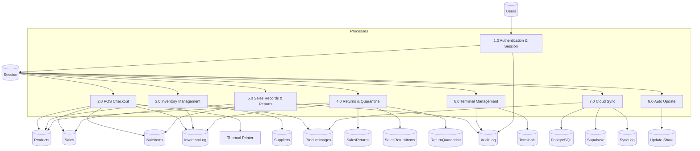

# Design Document

## 1. Database Design

### 1.1 Architecture Overview
JadeClinic uses a PostgreSQL database as its primary data store. The system is deployed in a LAN environment with the following components:

- **Database Server**: A local PostgreSQL instance hosted on the admin PC (default host `localhost`, port `5432`).
- **Clients**: Staff/POS terminals connect over the LAN to the PostgreSQL server via Npgsql.
- **Cloud Mirror**: Business data is synced to a Supabase PostgreSQL instance for reporting/web admin purposes.
- **File Storage**: Product/user/company images are stored as files in shared/local image folders and referenced by paths/URLs.

All database operations use Npgsql as the data provider (`Connection.GetConnectionString()` builds the connection string from `app.config` settings `PgHost`, `PgPort`, `PgDatabase`, `PgUser`, `PgPassword`). The application uses `DbProvider` to create connections and handle parameters.

### 1.2 Schema Overview
The schema is managed by `DatabaseInitializer` and various migration classes. Core tables are created in PostgreSQL with `BIGSERIAL` for primary keys, `TIMESTAMPTZ` for timestamps, and `DOUBLE PRECISION`/`NUMERIC` for monetary values.

### 1.3 Table Catalogue

#### 1.3.1 Users
**Purpose**: System user accounts for authentication and authorization.

| Column | Type | Null | Default | Constraints | Description |
| --- | --- | --- | --- | --- | --- |
| `UserID` | BIGSERIAL | No | auto | PRIMARY KEY | Unique identifier |
| `Username` | TEXT | No | - | UNIQUE | Login username |
| `PasswordHash` | TEXT | No | - | - | BCrypt password hash |
| `FullName` | TEXT | No | - | - | User's full name |
| `UserRole` | TEXT | Yes | 'Staff' | - | Role (Staff/Manager/Admin/SuperAdmin) |
| `IsActive` | INTEGER | Yes | 1 | - | Account status (1=active, 0=inactive) |
| `CreatedAt` | TIMESTAMPTZ | Yes | now() | - | Creation timestamp |
| `UpdatedAt` | TIMESTAMPTZ | Yes | now() | - | Last update timestamp |
| `pin` | INTEGER | Yes | NULL | - | 4-digit PIN |
| `PhotoPath` | TEXT | Yes | NULL | - | Profile photo file path |
| `QRCode` | TEXT | Yes | NULL | - | QR code identifier |
| `Email` | TEXT | Yes | NULL | - | Email address |
| `Phone` | TEXT | Yes | NULL | - | Phone number |
| `EmployeeCode` | TEXT | Yes | NULL | - | Employee code |
| `Passkeys` | TEXT | Yes | NULL | - | Comma-separated passkeys for recovery |

**Indexes**: `IX_Users_QRCode` on `QRCode`, `IX_Users_Role_Active` on `(UserRole, IsActive)`, `IX_Users_Email` on `Email`

#### 1.3.2 Suppliers
**Purpose**: Supplier directory for inventory restocking.

| Column | Type | Null | Default | Constraints | Description |
| --- | --- | --- | --- | --- | --- |
| `SupplierID` | BIGSERIAL | No | auto | PRIMARY KEY | Unique identifier |
| `SupplierCode` | TEXT | No | - | UNIQUE | Supplier code |
| `SupplierName` | TEXT | No | - | - | Supplier name |
| `ContactPerson` | TEXT | Yes | NULL | - | Contact person |
| `Phone` | TEXT | Yes | NULL | - | Phone number |
| `Email` | TEXT | Yes | NULL | - | Email address |
| `IsActive` | INTEGER | Yes | 1 | - | Status (1=active, 0=inactive) |

#### 1.3.3 Products
**Purpose**: Product catalog with pricing and stock information.

| Column | Type | Null | Default | Constraints | Description |
| --- | --- | --- | --- | --- | --- |
| `ProductID` | BIGSERIAL | No | auto | PRIMARY KEY | Unique identifier |
| `ProductCode` | TEXT | No | - | UNIQUE | Product SKU/code |
| `ProductName` | TEXT | No | - | - | Product name |
| `Category` | TEXT | Yes | NULL | - | Product category |
| `Unit` | TEXT | Yes | 'PCS' | - | Unit of measure |
| `CurrentStock` | INTEGER | Yes | 0 | - | Current stock quantity |
| `ReorderLevel` | INTEGER | Yes | 10 | - | Low stock threshold |
| `CostPrice` | DOUBLE PRECISION | No | - | - | Cost price |
| `SellingPrice` | DOUBLE PRECISION | No | - | - | Selling price |
| `SupplierID` | INTEGER | Yes | NULL | FOREIGN KEY → Suppliers(SupplierID) | Primary supplier |
| `IsActive` | INTEGER | Yes | 1 | - | Status (1=active, 0=inactive) |
| `Created` | TIMESTAMPTZ | Yes | now() | - | Creation timestamp |
| `WholesalePrice` | DOUBLE PRECISION | Yes | NULL | - | Wholesale price |
| `UpdatedAt` | TIMESTAMPTZ | Yes | now() | - | Last update timestamp |

**Indexes**: `IX_Products_Category_Active` on `(Category, IsActive)`, `IX_Products_Supplier` on `SupplierID`, `IX_Products_Name` on `ProductName`, `IX_Products_Stock_Alert` on `(CurrentStock ASC, ReorderLevel ASC, IsActive ASC)`

#### 1.3.4 ProductImages
**Purpose**: Image storage metadata for product images.

| Column | Type | Null | Default | Constraints | Description |
| --- | --- | --- | --- | --- | --- |
| `ImageID` | BIGSERIAL | No | auto | PRIMARY KEY | Unique identifier |
| `ImageHash` | TEXT | No | - | UNIQUE | Image hash for duplicate detection |
| `ImageType` | TEXT | Yes | 'thumb' | - | Image type (thumb/full) |
| `FilePath` | TEXT | No | - | - | File path to image |
| `CreatedAt` | TIMESTAMPTZ | Yes | now() | - | Creation timestamp |
| `UpdatedAt` | TIMESTAMPTZ | Yes | now() | - | Last update timestamp |

**Indexes**: `IX_ProductImages_Hash` on `ImageHash`

#### 1.3.5 ProductImageMapping
**Purpose**: Many-to-many relationship between products and images.

| Column | Type | Null | Default | Constraints | Description |
| --- | --- | --- | --- | --- | --- |
| `MappingID` | BIGSERIAL | No | auto | PRIMARY KEY | Unique identifier |
| `ProductID` | INTEGER | No | - | FOREIGN KEY → Products(ProductID) | Product reference |
| `ImageID` | INTEGER | No | - | FOREIGN KEY → ProductImages(ImageID) | Image reference |
| `CreatedAt` | TIMESTAMPTZ | Yes | now() | - | Creation timestamp |

**Constraints**: UNIQUE(`ProductID`, `ImageID`)  
**Indexes**: `IX_ProductImageMapping_Product` on `ProductID`

#### 1.3.6 Sales
**Purpose**: Sales transaction headers.

| Column | Type | Null | Default | Constraints | Description |
| --- | --- | --- | --- | --- | --- |
| `SaleID` | BIGSERIAL | No | auto | PRIMARY KEY | Unique identifier |
| `SaleNumber` | TEXT | Yes | NULL | - | Sale reference number (terminal-tagged) |
| `SaleDate` | TIMESTAMPTZ | Yes | now() | - | Sale timestamp |
| `CustomerName` | TEXT | Yes | NULL | - | Customer name (ephemeral) |
| `CustomerTIN` | TEXT | Yes | NULL | - | Customer TIN |
| `UserID` | INTEGER | Yes | NULL | FOREIGN KEY → Users(UserID) | Cashier |
| `TotalAmount` | DOUBLE PRECISION | Yes | 0 | - | Total amount |
| `AmountPaid` | DOUBLE PRECISION | Yes | 0 | - | Amount paid |
| `PaymentMethod` | TEXT | Yes | 'Cash' | - | Payment method (Cash/Card/E-Wallet) |
| `Reference` | TEXT | Yes | NULL | - | Payment reference |
| `SalesData` | TEXT | No | - | - | Serialized sales data |
| `Status` | TEXT | Yes | 'Completed' | - | Sale status (Completed/Aborted) |
| `ApprovedBy` | TEXT | Yes | NULL | - | Approver (for aborted sales) |
| `AbortReason` | TEXT | Yes | NULL | - | Abort reason |
| `DiscountType` | TEXT | Yes | NULL | - | Discount type |
| `DiscountAmount` | DOUBLE PRECISION | No | 0 | - | Discount amount |

**Indexes**: `IX_Sales_CustomerTIN` on `CustomerTIN`, `IX_Sales_SaleDate` on `SaleDate`, `IX_Sales_UserID` on `UserID`, `IX_Sales_SaleNumber` on `SaleNumber`

#### 1.3.7 SaleItems
**Purpose**: Sales transaction line items.

| Column | Type | Null | Default | Constraints | Description |
| --- | --- | --- | --- | --- | --- |
| `SaleItemID` | BIGSERIAL | No | auto | PRIMARY KEY | Unique identifier |
| `SaleID` | INTEGER | No | - | FOREIGN KEY → Sales(SaleID) | Sale header reference |
| `ProductID` | INTEGER | No | - | FOREIGN KEY → Products(ProductID) | Product reference |
| `Quantity` | INTEGER | No | - | - | Quantity sold |
| `UnitPrice` | DOUBLE PRECISION | No | - | - | Unit price at sale time |
| `OriginalUnitPrice` | DOUBLE PRECISION | Yes | NULL | - | Original unit price |
| `LineDiscountAmount` | DOUBLE PRECISION | No | 0 | - | Line-level discount |
| `SubTotal` | DOUBLE PRECISION | Yes | NULL | - | Line subtotal |

**Indexes**: `IX_SaleItems_Sale` on `SaleID`, `IX_SaleItems_Product` on `ProductID`

#### 1.3.8 SalesReturns
**Purpose**: Sales returns/exchanges headers.

| Column | Type | Null | Default | Constraints | Description |
| --- | --- | --- | --- | --- | --- |
| `ReturnID` | BIGSERIAL | No | auto | PRIMARY KEY | Unique identifier |
| `ReturnNumber` | TEXT | Yes | NULL | - | Return reference number |
| `SaleID` | INTEGER | No | - | FOREIGN KEY → Sales(SaleID) | Original sale reference |
| `ReturnDate` | TIMESTAMPTZ | No | now() | - | Return timestamp |
| `ReturnType` | TEXT | No | - | CHECK IN ('Refund','Exchange','Mixed') | Return type |
| `Reason` | TEXT | Yes | NULL | - | Return reason |
| `RefundAmount` | DOUBLE PRECISION | No | 0 | CHECK >= 0 | Refund amount |
| `ApprovedBy` | TEXT | Yes | NULL | - | Approver name |
| `ApprovedByUserID` | INTEGER | Yes | NULL | FOREIGN KEY → Users(UserID) | Approver user |
| `ProcessedBy` | INTEGER | Yes | NULL | FOREIGN KEY → Users(UserID) | Processor |
| `InitiatedBy` | INTEGER | Yes | NULL | FOREIGN KEY → Users(UserID) | Initiator |
| `Notes` | TEXT | Yes | NULL | - | Notes |
| `Status` | TEXT | No | 'Completed' | CHECK IN ('Completed','Cancelled','Reversed') | Status |
| `AdditionalPaymentAmount` | NUMERIC(18,2) | No | 0 | CHECK >= 0 | Additional payment for exchange |
| `SettlementMethod` | TEXT | Yes | NULL | - | Settlement method |
| `SettlementReference` | TEXT | Yes | NULL | - | Settlement reference |

**Indexes**: `IX_SalesReturns_Sale` on `SaleID`, `IX_SalesReturns_Date` on `ReturnDate`, `UX_SalesReturns_Number` unique partial on `ReturnNumber` WHERE NOT NULL

#### 1.3.9 SalesReturnItems
**Purpose**: Sales returns/exchanges line items.

| Column | Type | Null | Default | Constraints | Description |
| --- | --- | --- | --- | --- | --- |
| `ReturnItemID` | BIGSERIAL | No | auto | PRIMARY KEY | Unique identifier |
| `ReturnID` | INTEGER | No | - | FOREIGN KEY → SalesReturns(ReturnID) | Return header reference |
| `OriginalSaleItemID` | INTEGER | Yes | NULL | FOREIGN KEY → SaleItems(SaleItemID) | Original line item |
| `ProductID` | INTEGER | No | - | FOREIGN KEY → Products(ProductID) | Returned product |
| `Quantity` | INTEGER | No | - | CHECK > 0 | Quantity returned |
| `UnitPrice` | DOUBLE PRECISION | No | 0 | - | Unit price |
| `Condition` | TEXT | No | 'Good' | CHECK IN ('Good','Damaged') | Item condition |
| `Disposition` | TEXT | No | 'Quarantine' | CHECK IN ('Quarantine','Restock','WriteOff','ReturnToVendor') | Disposition |
| `LineRefundAmount` | DOUBLE PRECISION | No | 0 | CHECK >= 0 | Line refund amount |
| `ReturnCreditAmount` | NUMERIC(18,2) | No | 0 | CHECK >= LineRefundAmount | Return credit amount |
| `ReplacementProductID` | INTEGER | Yes | NULL | FOREIGN KEY → Products(ProductID) | Replacement product |
| `ReplacementQuantity` | INTEGER | Yes | NULL | CHECK > 0 if set | Replacement quantity |
| `ReplacementUnitPrice` | DOUBLE PRECISION | Yes | NULL | CHECK >= 0 if set | Replacement unit price |

**Indexes**: `IX_SalesReturnItems_Return` on `ReturnID`, `IX_SalesReturnItems_Original` on `OriginalSaleItemID`, `IX_SalesReturnItems_Product` on `ProductID`, `IX_SalesReturnItems_Replacement` on `ReplacementProductID`

#### 1.3.10 ReturnQuarantine
**Purpose**: Quarantine tracking for returned items.

| Column | Type | Null | Default | Constraints | Description |
| --- | --- | --- | --- | --- | --- |
| `QuarantineID` | BIGSERIAL | No | auto | PRIMARY KEY | Unique identifier |
| `ReturnItemID` | INTEGER | No | - | UNIQUE FOREIGN KEY → SalesReturnItems(ReturnItemID) | Return item reference |
| `ProductID` | INTEGER | No | - | FOREIGN KEY → Products(ProductID) | Product reference |
| `Quantity` | INTEGER | No | - | CHECK > 0 | Quantity in quarantine |
| `ItemCondition` | TEXT | No | - | - | Item condition |
| `Status` | TEXT | No | 'Pending' | CHECK IN ('Pending','Restocked','WrittenOff','ReturnedToVendor') | Quarantine status |
| `ReceivedAt` | TIMESTAMPTZ | No | now() | - | Received timestamp |
| `ResolvedAt` | TIMESTAMPTZ | Yes | NULL | - | Resolution timestamp |
| `ResolvedBy` | INTEGER | Yes | NULL | FOREIGN KEY → Users(UserID) | Resolver |
| `Notes` | TEXT | Yes | NULL | - | Notes |

**Indexes**: `IX_ReturnQuarantine_Status` on `(Status, ProductID)`

#### 1.3.11 InventoryLog
**Purpose**: Stock movement audit trail.

| Column | Type | Null | Default | Constraints | Description |
| --- | --- | --- | --- | --- | --- |
| `LogID` | BIGSERIAL | No | auto | PRIMARY KEY | Unique identifier |
| `ProductID` | INTEGER | No | - | FOREIGN KEY → Products(ProductID) | Product reference |
| `TransactionType` | TEXT | No | - | CHECK IN ('IN','OUT','ADJUST') | Transaction type |
| `Quantity` | INTEGER | No | - | CHECK > 0 | Quantity moved |
| `PreviousStock` | INTEGER | Yes | NULL | - | Stock before transaction |
| `NewStock` | INTEGER | Yes | NULL | - | Stock after transaction |
| `BatchNumber` | TEXT | Yes | NULL | - | Batch number |
| `ExpiryDate` | TEXT | Yes | NULL | - | Expiry date |
| `SupplierID` | INTEGER | Yes | NULL | FOREIGN KEY → Suppliers(SupplierID) | Supplier reference |
| `UserID` | INTEGER | No | - | FOREIGN KEY → Users(UserID) | User who performed action |
| `Reference` | TEXT | Yes | NULL | - | Reference number |
| `Notes` | TEXT | Yes | NULL | - | Notes |
| `CreatedAt` | TIMESTAMPTZ | Yes | now() | - | Transaction timestamp |

**Indexes**: `IX_InventoryLog_Product_Date` on `(ProductID, CreatedAt)`, `IX_InventoryLog_Date` on `CreatedAt`, `IX_InventoryLog_User` on `UserID`, `IX_InventoryLog_Batch` on `BatchNumber`, `IX_InventoryLog_Expiry` on `ExpiryDate`, `IX_InventoryLog_Reference` on `Reference`

#### 1.3.12 AuditLog
**Purpose**: Security and significant action audit trail.

| Column | Type | Null | Default | Constraints | Description |
| --- | --- | --- | --- | --- | --- |
| `AuditID` | BIGSERIAL | No | auto | PRIMARY KEY | Unique identifier |
| `Action` | TEXT | No | - | - | Action performed |
| `Details` | TEXT | Yes | NULL | - | Action details |
| `ActionTime` | TIMESTAMPTZ | Yes | now() | - | Action timestamp |
| `UserID` | INTEGER | Yes | NULL | FOREIGN KEY → Users(UserID) | User who performed action |

**Indexes**: `IX_AuditLog_UserID_ActionTime` on `(UserID, ActionTime)`

#### 1.3.13 CompanySettings
**Purpose**: Company/business configuration.

| Column | Type | Null | Default | Constraints | Description |
| --- | --- | --- | --- | --- | --- |
| `SettingID` | BIGSERIAL | No | auto | PRIMARY KEY | Unique identifier |
| `CompanyName` | TEXT | Yes | NULL | - | Company name |
| `Address` | TEXT | Yes | NULL | - | Company address |
| `Phone` | TEXT | Yes | NULL | - | Company phone |
| `Email` | TEXT | Yes | NULL | - | Company email |
| `TIN` | TEXT | Yes | NULL | - | Tax Identification Number |
| `LogoPath` | TEXT | Yes | NULL | - | Company logo path |
| `ReceiptHeader` | TEXT | Yes | NULL | - | Receipt header text |
| `ReceiptFooter` | TEXT | Yes | NULL | - | Receipt footer text |

#### 1.3.14 Terminals
**Purpose**: Terminal registration and access control.

| Column | Type | Null | Default | Constraints | Description |
| --- | --- | --- | --- | --- | --- |
| `TerminalID` | TEXT | No | - | PRIMARY KEY | Unique terminal identifier (GUID) |
| `TerminalName` | TEXT | Yes | NULL | - | Display name |
| `HostName` | TEXT | Yes | NULL | - | Windows machine name |
| `IsActive` | INTEGER | Yes | 0 | - | Active status (1=active, 0=inactive) |
| `Status` | TEXT | Yes | 'pending' | - | Status (pending/approved/blocked) |
| `LastSeenAt` | TIMESTAMPTZ | Yes | now() | - | Last heartbeat timestamp |
| `CreatedAt` | TIMESTAMPTZ | Yes | now() | - | Registration timestamp |

#### 1.3.15 SyncMarker
**Purpose**: Shared change marker for cross-terminal stock synchronization.

| Column | Type | Null | Default | Constraints | Description |
| --- | --- | --- | --- | --- | --- |
| `MarkerID` | BIGINT | No | - | PRIMARY KEY, CHECK (MarkerID = 1) | Fixed ID (always 1) |
| `LastChange` | TEXT | No | '0' | - | Monotonic counter (stored as text) |

#### 1.3.16 SyncLog
**Purpose**: Local sync/backup/restore/seed event log.

| Column | Type | Null | Default | Constraints | Description |
| --- | --- | --- | --- | --- | --- |
| `LogID` | BIGSERIAL | No | auto | PRIMARY KEY | Unique identifier |
| `StartedAt` | TIMESTAMPTZ | No | - | - | Sync start time |
| `CompletedAt` | TIMESTAMPTZ | Yes | NULL | - | Sync completion time |
| `RowsSynced` | INTEGER | No | 0 | - | Number of rows synced |
| `Status` | TEXT | No | 'running' | - | Status (running/completed/failed) |
| `Error` | TEXT | Yes | NULL | - | Error message |
| `Mode` | TEXT | Yes | NULL | - | Sync mode (auto/manual/full/smart) |
| `ReconcileDeleted` | INTEGER | No | 0 | - | Number of deleted rows reconciled |
| `SnapshotLocal` | INTEGER | No | 0 | - | Local snapshot created (1/0) |
| `SnapshotCloud` | INTEGER | No | 0 | - | Cloud snapshot uploaded (1/0) |

### 1.4 SyncMarker Trigger Mechanism
The `SyncMarker` table is bumped by PostgreSQL triggers on the `Products` table to notify all terminals of stock changes:

1. **Function**: `fn_sync_marker_bump()` - Updates `SyncMarker.LastChange` by incrementing the monotonic counter.
2. **Triggers** (on `Products`):
   - `trg_SyncMarker_Products_StockUpdate` - AFTER UPDATE OF `CurrentStock`
   - `trg_SyncMarker_Products_Insert` - AFTER INSERT
   - `trg_SyncMarker_Products_Delete` - AFTER DELETE
3. **Behavior**: Triggers fire within the writer's transaction, ensuring atomic change notification. Clients poll via `SyncMarkerTracker` every 2s (POS/Inventory) or 5s (Dashboard).

### 1.5 Migrations and Backups
- **Schema Creation**: `DatabaseInitializer.CreateDatabaseSchema()` creates all core tables on first run.
- **Migrations**: `SalesStatusMigration`, `EmployeeCodeMigration`, `SyncMarkerMigration`, `TerminalMigration`, `ReturnMigration` run at startup to maintain schema compatibility.
- **Backups**: `DatabaseSnapshot` module creates rolling snapshots (FIFO keep 5) and monthly backups. Uses `pg_dump` for PostgreSQL backups (gzipped). Backups stored locally in `Connection.GetBackupFolder()` and optionally uploaded to Supabase Storage.
- **Cloud Sync**: `SupabaseSync` performs full/delta sync of business data to Supabase PostgreSQL with image uploads to Supabase Storage.

### 1.6 Normalization Notes
The schema follows normalized design principles with appropriate foreign key relationships. `SalesData` in `Sales` table stores serialized data for receipt reconstruction. Customer information is ephemeral (stored per sale) as customers are not managed as a separate entity.

## 2. Component Design

### 2.1 Layered Architecture
```
Presentation Layer (Forms/) → Application Layer (Modules/) → Utilities Layer (Utilities/) → Data Layer (Connection/DatabaseHelper/DbProvider) → PostgreSQL Database
```

### 2.2 Component Catalogue

#### 2.2.1 Data Layer
| Component | Responsibility | Dependencies | Used By |
| --- | --- | --- | --- |
| `Connection.vb` | Connection string building, image/backup paths, connection testing | Npgsql, ConfigurationManager | All DB operations |
| `DatabaseHelper.vb` | SQL execution helpers (ExecuteNonQuery, ExecuteScalar, ExecuteReader, ExecuteDataTable) | DbProvider, Npgsql | All DB operations |
| `DbProvider.vb` | Connection creation, parameter conversion, identity retrieval | Npgsql, DbConnection | DatabaseHelper, all DB code |
| `DatabaseInitializer.vb` | Schema creation and initial data seeding | DatabaseHelper, all migrations | Application startup |

#### 2.2.2 Presentation Layer - Authentication & Shell
| Component | Responsibility | Dependencies | Used By |
| --- | --- | --- | --- |
| `Forms/Login/frmLoginvb.vb` | Password/PIN/QR login, passkey recovery, auto-update check | BCrypt, PasskeyManager, TerminalManager, AutoUpdater | Application entry |
| `Forms/Shell/MainShell.vb` | Main application frame, role-based navigation, page switching | Rbac, NavigationBuilder, HeaderUserControl | Post-login |
| `Forms/Shared/NavigationBuilder.vb` | Role-based menu construction | Rbac | MainShell |
| `Forms/Shared/HeaderUserControl.vb` | Header with user info, logout, version | Rbac, TerminalManager | MainShell |

#### 2.2.3 Presentation Layer - Sales/POS
| Component | Responsibility | Dependencies | Used By |
| --- | --- | --- | --- |
| `Forms/Sales/Sales.vb` | Main POS interface, cart management, checkout | ProductCardBuilder, OrderSummaryGridBuilder, EmptyCartStateBuilder, PaginationControl, EscPosPrinter, ReceiptRenderer, SyncMarkerTracker | MainShell |
| `Forms/Sales/ProductCardBuilder.vb` | Product card grid rendering | - | Sales |
| `Forms/Sales/OrderSummaryGridBuilder.vb` | Cart grid rendering | - | Sales |
| `Forms/Sales/EmptyCartStateBuilder.vb` | Empty cart state display | - | Sales |
| `Forms/Sales/PaginationControl.vb` | Product grid pagination | - | Sales |

#### 2.2.4 Presentation Layer - Inventory
| Component | Responsibility | Dependencies | Used By |
| --- | --- | --- | --- |
| `Forms/Inventory/Inventory.vb` | Inventory listing, stock management | InventoryExporter, SyncMarkerTracker, ImageCompression | MainShell |
| `Forms/Inventory/AddProduct.vb` | Product CRUD | ImageCompression, ProductImages handling | Inventory |
| `Forms/Inventory/InventoryExporter.vb` | Inventory export functionality | - | Inventory |
| `Forms/Inventory/QuarantineInspectionForm.vb` | Quarantine item inspection | - | Inventory/Returns |

#### 2.2.5 Presentation Layer - Inventory Log
| Component | Responsibility | Dependencies | Used By |
| --- | --- | --- | --- |
| `Forms/InventoryLog/InventoryLog.vb` | Stock movement history | InventoryLogExporter, SyncMarkerTracker | MainShell |
| `Forms/InventoryLog/AddInventoryLogForm.vb` | Manual stock adjustments/restocks | - | InventoryLog |
| `Forms/InventoryLog/InventoryLogExporter.vb` | Inventory log export | - | InventoryLog |

#### 2.2.6 Presentation Layer - Sales Records & Returns
| Component | Responsibility | Dependencies | Used By |
| --- | --- | --- | --- |
| `Forms/Sales_Record/SalesRecord.vb` | Sales history listing | SalesRecordExporter | MainShell |
| `Forms/Sales_Record/SalesDetails.vb` | Sale details, reprint | EscPosPrinter, ReceiptRenderer | SalesRecord |
| `Forms/Sales_Record/ReturnExchangeForm.vb` | Returns/exchanges processing | ReturnExchangeTheme, Rbac | SalesDetails |
| `Forms/Sales_Record/SalesRecordExporter.vb` | Sales record export | - | SalesRecord |

#### 2.2.7 Presentation Layer - Staff, Users, Suppliers
| Component | Responsibility | Dependencies | Used By |
| --- | --- | --- | --- |
| `Forms/Staff/Staff.vb` | Staff listing | StaffExporter, Rbac | MainShell |
| `Forms/Staff/AddStaff.vb` | Staff CRUD with QR/ID cards | - | Staff |
| `Forms/Staff/IdCard.vb`, `Forms/Staff/IdCardBack.vb` | ID card generation | MessagingToolkit.QRCode | Staff |
| `Forms/UserManagement/AddUserForm.vb` | User account management | Rbac | System/Staff |
| `Forms/Supplier/Supplier.vb` | Supplier management | SupplierExporter | MainShell |
| `Forms/Supplier/SupplierExporter.vb` | Supplier export | - | Supplier |

#### 2.2.8 Presentation Layer - Audit, System, Profile
| Component | Responsibility | Dependencies | Used By |
| --- | --- | --- | --- |
| `Forms/AuditLog/AuditLog.vb` | Audit trail viewing | AuditExporter, Rbac | MainShell |
| `Forms/AuditLog/AuditExporter.vb` | Audit log export | - | AuditLog |
| `Forms/System/Sys.vb` | System settings, cloud sync, backups | Rbac, SupabaseSync, SyncQueue, DatabaseSnapshot, TerminalManager | MainShell |
| `Forms/System/TerminalSetup.vb` | Terminal registration/approval | TerminalManager, Rbac | System |
| `Forms/System/SyncLogs.vb` | Sync log viewing | LocalSyncLog, Rbac | System |
| `Forms/System/UpdateProgressForm.vb`, `Forms/System/ApplyingUpdateForm.vb` | Update UI | AutoUpdater | Login/Update |
| `Forms/ProfileSettings/ProfileSettings.vb` | Profile management, passkeys | PasskeyManager | MainShell |

#### 2.2.9 Application Layer (Modules)
| Component | Responsibility | Dependencies | Used By |
| --- | --- | --- | --- |
| `Modules/Rbac.vb` | Role-based access control, permission checks | frmLoginvb | All forms requiring authorization |
| `Modules/ReceiptRenderer.vb` | Receipt layout generation | - | Sales, SalesDetails, EscPosPrinter |
| `Modules/EscPosPrinter.vb` | Raw ESC/POS thermal printing via winspool | System.Runtime.InteropServices | Sales, SalesDetails |
| `Modules/SupabaseSync.vb` | Cloud sync to Supabase (full/delta, images) | Npgsql, AWSSDK.S3, Newtonsoft.Json, LocalSyncLog | SyncQueue, Sys |
| `Modules/SyncQueue.vb` | Background sync queue with debounce/schedule | SupabaseSync, LocalSyncLog | Application, Sys |
| `Modules/LocalSyncLog.vb` | Local sync log storage and retrieval | Npgsql, DatabaseHelper | SyncQueue, SyncLogs |
| `Modules/DatabaseSnapshot.vb` | Database backups (rolling/monthly) | Npgsql, SupabaseSync, Connection | SyncQueue, Sys |
| `Modules/IdleTimeoutManager.vb` | Auto-lock on inactivity | - | Application |
| `Modules/CompanySettingsManager.vb` | Company settings access | DatabaseHelper | Forms |
| `Modules/Branding.vb` | Branding utilities | - | Forms |
| `Modules/DemoDataSeeder.vb` | Demo data generation | DatabaseHelper | Sys (SuperAdmin) |
| `Modules/SuperAdminSeeder.vb` | SuperAdmin account seeding | DatabaseHelper, BCrypt | DatabaseInitializer |

#### 2.2.10 Utilities Layer
| Component | Responsibility | Dependencies | Used By |
| --- | --- | --- | --- |
| `Utilities/TerminalManager.vb` | Terminal registration, approval, heartbeat | DbProvider, Npgsql, JsonSerializer | Application, Login, Sys, TerminalSetup |
| `Utilities/SyncMarkerTracker.vb` | SyncMarker polling for change detection | DatabaseHelper | Sales, Inventory, InventoryLog (forms with polling) |
| `Utilities/AutoUpdater.vb` | LAN share auto-update mechanism | System.Diagnostics, System.IO | frmLoginvb, Update forms |
| `Utilities/PasskeyManager.vb` | Passkey management for recovery | DatabaseHelper | Login, ProfileSettings |
| `Utilities/ImageCompression.vb` | Image compression and processing | System.Drawing | AddProduct, Profile |
| `Utilities/SalesStatusMigration.vb` | Sales schema migration | DbProvider, DatabaseHelper | DatabaseInitializer, Connection |
| `Utilities/EmployeeCodeMigration.vb` | Employee code migration | DbProvider, DatabaseHelper | DatabaseInitializer, Connection |
| `Utilities/SyncMarkerMigration.vb` | SyncMarker table/triggers creation | DbProvider | DatabaseInitializer, Connection |
| `Utilities/TerminalMigration.vb` | Terminals table creation | DbProvider, DatabaseHelper | DatabaseInitializer, TerminalManager |
| `Utilities/ReturnMigration.vb` | Returns/quarantine schema migration | Npgsql | DatabaseInitializer, Connection |
| `Utilities/BatchTrackingMigration.vb` | Batch tracking schema migration | DbProvider, DatabaseHelper | DatabaseInitializer |

## 3. Data Flow Diagram

### 3.1 Level 0 Context Diagram


**External Entities:**
- Staff/Cashier, Manager, Admin/SuperAdmin - System users
- Supplier - External supplier
- Thermal Printer - Receipt printing
- LAN Terminals - Other POS terminals
- Supabase - Cloud database
- LAN Update Share - Auto-update source

**Data Flows:**
- User credentials → Authentication
- Sale transactions → Database
- Inventory updates → Database
- Receipts → Printer
- Data → Cloud sync
- Updates ← Update share

### 3.2 Level 1 Data Flow Diagram


**Data Stores:**
- D1: Users - User accounts and credentials
- D2: Products - Product catalog and stock
- D3: Suppliers - Supplier information
- D4: Sales/SaleItems - Sales transactions
- D5: InventoryLog - Stock movements
- D6: SalesReturns/SalesReturnItems - Returns
- D7: ReturnQuarantine - Quarantine tracking
- D8: ProductImages/ProductImageMapping - Images
- D9: AuditLog - Audit trail
- D10: Terminals - Terminal registry
- D11: SyncMarker - Change notification
- D12: SyncLog - Sync history
- D13: CompanySettings - Configuration

**Process Descriptions:**
1. **Authentication & Session**: Validates credentials (username/password/PIN/QR/passkeys), checks terminal approval, creates session, logs to audit
2. **POS Checkout**: Builds cart, validates stock via `SyncMarker`, processes payment, creates sale atomically, decrements stock, prints receipt
3. **Inventory Management**: CRUD products/suppliers, stock adjustments, image management, tracks stock movements
4. **Returns & Quarantine**: Processes returns/exchanges, manages quarantine, handles restock/writeoff/return-to-vendor
5. **Sales Records & Reports**: Views sales history, generates reports, exports data
6. **Terminal Management**: Registers terminals, admin approves/blocks, heartbeat tracking
7. **Cloud Sync**: Syncs data to Supabase, uploads images, manages sync queue/logs
8. **Auto Update**: Checks update share, downloads and applies updates

## 4. Security Design

### 4.1 Authentication
| Method | Description | Security Measures |
| --- | --- | --- |
| Username/Password | Primary login | BCrypt password hashing |
| 4-Digit PIN | Secondary authentication after password | PIN attempt lockout, logged to audit |
| QR Login | QR code-based login for admins/managers | Role-restricted, terminal-aware |
| Passkey Recovery | Forgot PIN via 3 registered passkeys | Passkey validation, logged to audit |
| Idle Timeout | Auto-lock after inactivity | `IdleTimeoutManager`, session invalidation |

### 4.2 Authorization
Role hierarchy: **Staff < Manager < Admin < SuperAdmin**

| Permission | Staff | Manager | Admin | SuperAdmin |
| --- | --- | --- | --- | --- |
| POS Sales | ✓ | ✓ | ✓ | ✓ |
| View Sales Records | ✓ | ✓ | ✓ | ✓ |
| Inventory View | ✓ | ✓ | ✓ | ✓ |
| Inventory Adjustments | ✗ | ✓ | ✓ | ✓ |
| Supplier Management | ✗ | ✓ | ✓ | ✓ |
| Staff View | ✗ | ✓ | ✓ | ✓ |
| Staff Management | ✗ | ✓ | ✓ | ✓ |
| User Management | ✗ | ✗ | ✓ | ✓ |
| Audit Logs | ✗ | ✗ | ✓ | ✓ |
| Sync Logs | ✗ | ✗ | ✓ | ✓ |
| Cloud Sync | ✗ | ✗ | ✓ | ✓ |
| Backups | ✗ | ✗ | ✓ | ✓ |
| Terminal Management | ✗ | ✓ | ✓ | ✓ |
| Database Restore | ✗ | ✗ | ✗ | ✓ |
| Demo Data | ✗ | ✗ | ✗ | ✓ |
| Force Full Sync | ✗ | ✗ | ✗ | ✓ |
| Create Admin/SuperAdmin | ✗ | ✗ | ✗ | ✓ |

Authorization is enforced at the shell level via `Rbac` module and `MainShell.EnforceRoleAccess`. Navigation is built per-role.

### 4.3 Terminal Security
| Control | Description |
| --- | --- |
| Registration | Each terminal generates unique GUID identity stored in `%LocalAppData%\JadeClinic\terminal.json` |
| Pending State | New terminals register as pending and cannot operate until approved |
| Approval/Blocking | Only admin machine (matching `AdminMachineName` config) can approve/block terminals |
| Auto-Approval | Admin machine or first terminal is auto-approved to prevent lockout |
| Heartbeat | 30-second heartbeat updates `LastSeenAt` for online status tracking |
| Access Gate | `TerminalManager.GetTerminalAccessStatus()` blocks pending/blocked terminals at startup |

### 4.4 Audit Trail
All sensitive actions are logged to `AuditLog`:
- Login/logout
- PIN attempts and lockouts
- PIN reset via passkeys
- Void/abort sales
- Capital unlock
- Terminal approval/blocking
- Configuration changes
- User/role changes
- Database operations (backup/restore/seed)
- Returns/exchanges approval

### 4.5 Secrets and Configuration
| Item | Storage | Protection |
| --- | --- | --- |
| Database credentials | `app.config` (PgUser/PgPassword) | Local file, production deployment |
| Supabase connection/S3 keys | `%LocalAppData%\JadeClinic\supabase.config.json` | Git-ignored, outside repo |
| Update path | `app.config` (UpdatePath) | LAN share path |
| Terminal identity | `%LocalAppData%\JadeClinic\terminal.json` | Local per-machine |
| Images/Backups | Configured paths (local/LAN share) | Filesystem permissions |

### 4.6 Network and Cloud Security
| Control | Description |
| --- | --- |
| Local Transport | PostgreSQL on LAN (trusted network) |
| Cloud Role | Supabase uses read-only role `dashboard_ro` for web access with SELECT-only grants |
| Row Level Security | RLS enabled on Supabase tables with read-only policies for authenticated users |
| Credential Stripping | `SupabaseSync` drops sensitive fields (PasswordHash, PIN, Passkeys, QRCode) before syncing users |
| Image Access | Images served via Supabase Storage public URLs or LAN shares |

### 4.7 Threat/Risk Mitigation
| Threat | Risk | Mitigation |
| --- | --- | --- |
| Unauthorized access | High | BCrypt, PIN, role-based access, terminal approval, session timeout |
| SQL injection | High | Parameterized queries via Npgsql/DatabaseHelper |
| Brute force PIN | High | PIN attempt lockout, audit logging |
| Stock oversell | High | Atomic conditional `UPDATE ... WHERE CurrentStock >= @Qty`, pre-check validation |
| Data breach (cloud) | Medium | Read-only cloud role, RLS, credential stripping, no writes from web |
| Terminal spoofing | Medium | GUID-based identity, admin-hostname gate, pending approval |
| SMB/LAN issues | Medium | PostgreSQL over TCP (replacing SMB-shared files) |
| Update tampering | Medium | LAN share on admin PC, version checking |

## 5. Performance Design

### 5.1 Database Performance
| Technique | Implementation | Purpose |
| --- | --- | --- |
| Indexing | Strategic indexes on foreign keys, search fields, dates | Fast lookups and filtering |
| Connection Management | `DbProvider.CreateConnection()` with Npgsql | Connection pooling |
| Timeouts | Connection timeout 15s, command timeout 30s | Prevent hanging |
| Atomic Operations | Transactional checkout with conditional updates | Data integrity, prevent oversell |

### 5.2 Caching and Synchronization
| Technique | Implementation | Purpose |
| --- | --- | --- |
| SyncMarker Polling | 2s for POS/Inventory, 5s for Dashboard | Cross-terminal stock updates without websockets |
| Local Caching | In-memory cart, cached data in forms | Reduce DB round trips |
| Debounced Sync | 60s debounce for auto-sync after changes | Batch cloud sync operations |
| Scheduled Sync | 30-minute scheduled sync | Periodic cloud synchronization |

### 5.3 UI Performance
| Technique | Implementation | Purpose |
| --- | --- | --- |
| Pagination | `PaginationControl` for product grid | Handle large product catalogs |
| Lazy Loading | Data loaded on demand per page | Reduce initial load time |
| Image Compression | `ImageCompression` for uploads | Smaller image sizes |
| Background Processing | `SyncQueue` with Task.Run | Non-blocking operations |

### 5.4 Scalability Considerations
| Aspect | Design | Notes |
| --- | --- | --- |
| Terminal Count | LAN-based, low count expected | PostgreSQL handles concurrent connections |
| Data Volume | Clinic-scale transaction volume | Standard PostgreSQL performance sufficient |
| Sync Frequency | Debounced + scheduled | Reduces cloud API calls |
| Backup Size | Gzipped snapshots | Throttled and size-limited for cloud upload |

### 5.5 Performance Constraints
- Self-contained single-file exe ~220 MB
- LAN-dependent (requires network connectivity to database)
- Polling-based sync (not real-time websockets)
- Carts stored in-memory only (no cross-terminal reservation)

## 6. Third-Party Integration

### 6.1 Integration Catalogue
| Library/Service | Version | Purpose | Configuration | Data Exchanged | Failure Handling |
| --- | --- | --- | --- | --- | --- |
| **Npgsql** | 10.0.3 | PostgreSQL data provider for .NET | `app.config` Pg* settings | SQL queries, parameters, results | Connection testing, timeouts, exception logging |
| **PostgreSQL** | Local instance | Primary database | Local installation on admin PC | All application data | Connection validation, schema migrations |
| **Supabase (PostgreSQL)** | Cloud | Cloud database mirror | `supabase.config.json` connection string | Synced business data (filtered) | Graceful failure, logged to SyncLog |
| **AWSSDK.S3** | 3.7.511.8 | Supabase Storage S3-compatible API | `supabase.config.json` S3 section | Product/user/company images | Upload failures logged, sync continues |
| **BCrypt.Net-Next** | 4.0.3 | Password hashing | N/A | Password hashes | Standard BCrypt operations |
| **Guna.UI2.WinForms** | 2.0.4.7 | UI components and styling | N/A | UI elements | Standard UI framework |
| **LiveChartsCore** | 2.0.0-rc5.4 | Charts and visualizations | N/A | Chart data from dashboard | Rendering fallbacks |
| **LiveChartsCore.SkiaSharpView** | 2.0.0-rc5.4 | SkiaSharp chart rendering | N/A | Chart rendering | Standard rendering |
| **SkiaSharp** | 3.116.1 | 2D graphics rendering | N/A | Image/chart rendering | Standard graphics |
| **QuestPDF** | 2025.12.3 | PDF generation | N/A | Report data | PDF generation error handling |
| **MessagingToolkit.QRCode** | (Lib) | QR code generation | N/A | User/staff QR codes | QR generation |
| **MessagingToolkit.Barcode** | (Lib) | Barcode support | N/A | Barcode data | Barcode operations |
| **Newtonsoft.Json** | 13.0.4 | JSON serialization | N/A | Config, sales data, sync payloads | Serialization error handling |
| **Windows Print Spooler (winspool.drv)** | System | Raw ESC/POS thermal printing | Printer name from settings | Raw ESC/POS bytes | Fallback to GDI, error logging |

### 6.2 Integration Details

#### 6.2.1 Npgsql/PostgreSQL
- **Purpose**: Primary database connectivity
- **Connection**: TCP to PostgreSQL server on LAN
- **Features Used**: Parameterized queries, transactions, `BIGSERIAL`, `TIMESTAMPTZ`, stored functions/triggers
- **Error Handling**: Connection tests, command timeouts, exception logging

#### 6.2.2 Supabase
- **Purpose**: Cloud data mirror and storage
- **Sync Strategy**: Full upsert by `local_id`, FK resolution with ID mapping, credential stripping
- **Tables Synced**: Users (filtered), Suppliers, Products, Sales, SaleItems, SalesReturns, SalesReturnItems, ReturnQuarantine, InventoryLog, AuditLog
- **Error Handling**: Sync logged to `SyncLog`, failures don't block local operations

#### 6.2.3 AWSSDK.S3 (Supabase Storage)
- **Purpose**: Image uploads to cloud storage
- **Bucket**: `Jade_Web_Bucket` with `images/` prefix
- **Paths**: `images/avatar/`, `images/product/`, `images/company/`
- **Error Handling**: Upload failures logged, URLs remain NULL if upload fails

#### 6.2.4 Thermal Printing (ESC/POS)
- **Purpose**: Receipt printing on thermal printers
- **Method**: Raw byte stream via Windows Print Spooler
- **Fallback**: GDI printing if ESC/POS fails
- **Formats**: 58mm/80mm (32/42 chars per line)

#### 6.2.5 Auto-Updater
- **Purpose**: LAN-based application updates
- **Source**: `\\<admin>\JadeClinicUpdates` share
- **Process**: Version check → download → staged launch → file replacement → restart
- **Safety**: Process wait, retry on file locks, cleanup
