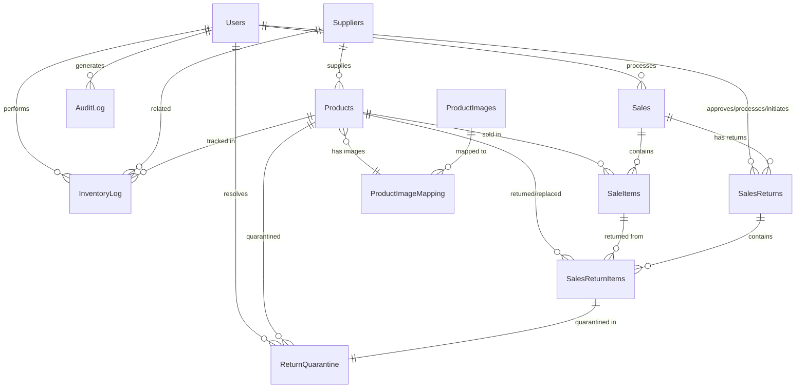

# Requirements Specification

## 1. Functional Requirements

### 1.1 Authentication & Session Management
| Req ID | Requirement | Priority | Source |
| --- | --- | --- | --- |
| FR-001 | System shall authenticate users using username and password with BCrypt hashing | Must | `Forms/Login/frmLoginvb.vb` |
| FR-002 | System shall require 4-digit PIN after successful password authentication | Must | `Forms/Login/frmLoginvb.vb` |
| FR-003 | System shall support QR code login for Admin and Manager roles | Must | `Forms/Login/frmLoginvb.vb` |
| FR-004 | System shall support passkey-based PIN recovery using 3 registered passkeys | Must | `Forms/Login/ForgotPasswordForm.vb`, `Utilities/PasskeyManager.vb` |
| FR-005 | System shall lock account/app after exceeding maximum PIN attempts and log to audit | Must | `Forms/Login/frmLoginvb.vb` |
| FR-006 | System shall auto-lock session after inactivity period via IdleTimeoutManager | Must | `Modules/IdleTimeoutManager.vb` |
| FR-007 | System shall enforce role-based access to forms and features | Must | `Modules/Rbac.vb`, `Forms/Shell/MainShell.vb` |
| FR-008 | System shall display user information and role in header | Must | `Forms/Shared/HeaderUserControl.vb` |

### 1.2 Terminal Management
| Req ID | Requirement | Priority | Source |
| --- | --- | --- | --- |
| FR-009 | System shall generate unique terminal identity per machine on first run | Must | `Utilities/TerminalManager.vb` |
| FR-010 | New terminals shall register as pending and require admin approval | Must | `Utilities/TerminalManager.vb` |
| FR-011 | Only admin machine shall be able to approve/block terminals | Must | `Utilities/TerminalManager.vb` |
| FR-012 | Admin machine or first terminal shall be auto-approved to prevent lockout | Must | `Utilities/TerminalManager.vb` |
| FR-013 | System shall send heartbeat every 30 seconds to track terminal online status | Must | `Utilities/TerminalManager.vb` |
| FR-014 | System shall block pending/blocked terminals from accessing the application | Must | `Utilities/TerminalManager.vb` |
| FR-015 | Admin shall be able to rename and manage terminals | Must | `Forms/System/TerminalSetup.vb` |

### 1.3 POS Sales & Checkout
| Req ID | Requirement | Priority | Source |
| --- | --- | --- | --- |
| FR-016 | System shall display products in card grid with categories, search, and pagination | Must | `Forms/Sales/Sales.vb`, `Forms/Sales/ProductCardBuilder.vb` |
| FR-017 | System shall support barcode scanning for product lookup | Must | `Forms/Sales/Sales.vb` |
| FR-018 | System shall maintain cart with quantities, discounts, and customer information | Must | `Forms/Sales/OrderSummaryGridBuilder.vb` |
| FR-019 | System shall require capital lock unlock by Admin/Manager before first sale of day | Must | `Forms/Sales/Sales.vb` |
| FR-020 | System shall validate stock before payment and block if insufficient/changed | Must | `Forms/Sales/Sales.vb` |
| FR-021 | System shall perform atomic stock decrement on checkout to prevent oversell | Must | `Forms/Sales/Sales.vb` |
| FR-022 | System shall support Cash, Card, and E-Wallet (GCash/Maya) payment methods | Must | `Forms/Sales/Sales.vb` |
| FR-023 | System shall calculate change for cash payments | Must | `Forms/Sales/Sales.vb` |
| FR-024 | System shall apply VAT 12% (Philippine) to sales | Must | `Forms/Sales/Sales.vb` |
| FR-025 | System shall tag sale IDs with terminal prefix for traceability | Must | `Forms/Sales/Sales.vb` |
| FR-026 | System shall persist cart draft between sessions | Must | `Forms/Sales/Sales.vb` |
| FR-027 | System shall support void/abort sales with approval and reason logging | Must | `Forms/Sales/Sales.vb` |

### 1.4 Receipts
| Req ID | Requirement | Priority | Source |
| --- | --- | --- | --- |
| FR-028 | System shall generate thermal receipts via ESC/POS for receipt printers | Must | `Modules/EscPosPrinter.vb`, `Modules/ReceiptRenderer.vb` |
| FR-029 | System shall fallback to GDI printing for non-thermal printers | Must | `Modules/EscPosPrinter.vb` |
| FR-030 | System shall display receipt preview before printing | Must | `Forms/Shared/EscPosPreviewForm.vb` |
| FR-031 | System shall support receipt reprint from sales records | Must | `Forms/Sales_Record/SalesDetails.vb` |
| FR-032 | System shall include company header/footer on receipts | Must | `Modules/CompanySettingsManager.vb` |

### 1.5 Inventory Management
| Req ID | Requirement | Priority | Source |
| --- | --- | --- | --- |
| FR-033 | System shall provide product CRUD with code, name, category, unit, barcode | Must | `Forms/Inventory/AddProduct.vb` |
| FR-034 | System shall manage cost price, selling price, and wholesale price | Must | `Forms/Inventory/AddProduct.vb` |
| FR-035 | System shall track current stock and reorder level per product | Must | `Forms/Inventory/Inventory.vb` |
| FR-036 | System shall support product images with compression and mapping | Must | `Forms/Inventory/AddProduct.vb`, `Utilities/ImageCompression.vb` |
| FR-037 | System shall highlight low stock and out of stock products | Must | `Forms/Inventory/Inventory.vb` |
| FR-038 | System shall support product search and filtering by category | Must | `Forms/Inventory/Inventory.vb` |
| FR-039 | System shall support batch tracking with batch number and expiry date | Must | `Forms/InventoryLog/AddInventoryLogForm.vb` |
| FR-040 | System shall provide inventory export functionality | Must | `Forms/Inventory/InventoryExporter.vb` |

### 1.6 Inventory Log
| Req ID | Requirement | Priority | Source |
| --- | --- | --- | --- |
| FR-041 | System shall log all stock movements (IN, OUT, ADJUST) with user, date, reference | Must | `Forms/InventoryLog/InventoryLog.vb` |
| FR-042 | System shall track previous stock and new stock for each movement | Must | `Forms/InventoryLog/InventoryLog.vb` |
| FR-043 | System shall support manual stock adjustments and restocking | Must | `Forms/InventoryLog/AddInventoryLogForm.vb` |
| FR-044 | System shall provide inventory log export functionality | Must | `Forms/InventoryLog/InventoryLogExporter.vb` |
| FR-045 | System shall update product stock atomically on inventory log entry | Must | `Forms/InventoryLog/AddInventoryLogForm.vb` |

### 1.7 Returns, Exchanges & Quarantine
| Req ID | Requirement | Priority | Source |
| --- | --- | --- | --- |
| FR-046 | System shall support returns (Refund), exchanges, and mixed returns | Must | `Forms/Sales_Record/ReturnExchangeForm.vb` |
| FR-047 | System shall validate returns against original sale items and quantities | Must | `Forms/Sales_Record/ReturnExchangeForm.vb` |
| FR-048 | System shall calculate refunds and handle additional payments for exchanges | Must | `Forms/Sales_Record/ReturnExchangeForm.vb` |
| FR-049 | System shall track item condition (Good/Damaged) on returns | Must | `Forms/Sales_Record/ReturnExchangeForm.vb` |
| FR-050 | System shall route items to quarantine based on disposition | Must | `Forms/Sales_Record/ReturnExchangeForm.vb` |
| FR-051 | System shall manage quarantine with statuses (Pending/Restocked/WrittenOff/ReturnedToVendor) | Must | `Forms/Inventory/QuarantineInspectionForm.vb` |
| FR-052 | System shall update stock on restock from quarantine | Must | `Forms/Inventory/QuarantineInspectionForm.vb` |
| FR-053 | System shall require approval for returns with role-based permissions | Must | `Forms/Sales_Record/ReturnExchangeForm.vb` |

### 1.8 Sales Records
| Req ID | Requirement | Priority | Source |
| --- | --- | --- | --- |
| FR-054 | System shall display sales history with filters and search | Must | `Forms/Sales_Record/SalesRecord.vb` |
| FR-055 | System shall show detailed sale information including line items | Must | `Forms/Sales_Record/SalesDetails.vb` |
| FR-056 | System shall support sales record export | Must | `Forms/Sales_Record/SalesRecordExporter.vb` |
| FR-057 | System shall track sale status (Completed/Aborted) | Must | `Forms/Sales_Record/SalesRecord.vb` |

### 1.9 Staff, Users & Suppliers
| Req ID | Requirement | Priority | Source |
| --- | --- | --- | --- |
| FR-058 | System shall manage staff records with roles and employee codes | Must | `Forms/Staff/Staff.vb`, `Forms/Staff/AddStaff.vb` |
| FR-059 | System shall generate ID cards with QR codes for staff | Must | `Forms/Staff/IdCard.vb`, `Forms/Staff/IdCardBack.vb` |
| FR-060 | System shall manage user accounts linked to roles | Must | `Forms/UserManagement/AddUserForm.vb` |
| FR-061 | System shall enforce role assignment permissions (Admin can assign up to Manager, SuperAdmin can assign all) | Must | `Modules/Rbac.vb` |
| FR-062 | System shall manage supplier directory with contact information | Must | `Forms/Supplier/Supplier.vb` |
| FR-063 | System shall support supplier export | Must | `Forms/Supplier/SupplierExporter.vb` |

### 1.10 Audit, Settings & System
| Req ID | Requirement | Priority | Source |
| --- | --- | --- | --- |
| FR-064 | System shall log all sensitive actions to audit trail | Must | `Modules/*`, `Forms/AuditLog/AuditLog.vb` |
| FR-065 | System shall provide audit log viewing and export with role restrictions | Must | `Forms/AuditLog/AuditLog.vb`, `Forms/AuditLog/AuditExporter.vb` |
| FR-066 | System shall manage company settings (name, address, TIN, logo, receipt header/footer) | Must | `Forms/System/Sys.vb`, `Modules/CompanySettingsManager.vb` |
| FR-067 | System shall provide database backup functionality for Admin/SuperAdmin | Must | `Forms/System/Sys.vb`, `Modules/DatabaseSnapshot.vb` |
| FR-068 | System shall provide database restore functionality for SuperAdmin only | Must | `Forms/System/Sys.vb` |
| FR-069 | System shall support demo data seeding for SuperAdmin | Must | `Modules/DemoDataSeeder.vb` |
| FR-070 | System shall manage user profile including password/PIN/passkeys | Must | `Forms/ProfileSettings/ProfileSettings.vb` |

### 1.11 Cloud Sync
| Req ID | Requirement | Priority | Source |
| --- | --- | --- | --- |
| FR-071 | System shall sync business data to Supabase PostgreSQL | Must | `Modules/SupabaseSync.vb` |
| FR-072 | System shall support full and delta sync modes | Must | `Modules/SupabaseSync.vb`, `Modules/SyncQueue.vb` |
| FR-073 | System shall upload product/user/company images to Supabase Storage | Must | `Modules/SupabaseSync.vb` |
| FR-074 | System shall strip sensitive credentials before syncing users | Must | `Modules/SupabaseSync.vb` |
| FR-075 | System shall queue sync operations with debounce (60s) and schedule (30min) | Must | `Modules/SyncQueue.vb` |
| FR-076 | System shall log all sync operations to local and cloud sync logs | Must | `Modules/LocalSyncLog.vb`, `Modules/SupabaseSync.vb` |
| FR-077 | System shall trigger sync on sales and inventory changes | Must | `Forms/Sales/Sales.vb`, `Forms/InventoryLog/AddInventoryLogForm.vb` |
| FR-078 | System shall support manual sync trigger from System Settings | Must | `Forms/System/Sys.vb` |

### 1.12 Auto-Update
| Req ID | Requirement | Priority | Source |
| --- | --- | --- | --- |
| FR-079 | System shall check for updates from LAN share on login | Must | `Forms/Login/frmLoginvb.vb`, `Utilities/AutoUpdater.vb` |
| FR-080 | System shall automatically download and apply updates without user prompt | Must | `Utilities/AutoUpdater.vb` |
| FR-081 | System shall stage updates and relaunch application after file replacement | Must | `Utilities/AutoUpdater.vb` |
| FR-082 | System shall handle file lock retries during update application | Must | `Utilities/AutoUpdater.vb` |
| FR-083 | System shall display update progress to user | Must | `Forms/System/UpdateProgressForm.vb`, `Forms/System/ApplyingUpdateForm.vb` |

### 1.13 Cross-Terminal Synchronization
| Req ID | Requirement | Priority | Source |
| --- | --- | --- | --- |
| FR-084 | System shall use SyncMarker for change detection across terminals | Must | `Utilities/SyncMarkerMigration.vb`, `Utilities/SyncMarkerTracker.vb` |
| FR-085 | POS and Inventory shall poll for changes every 2 seconds | Must | `Forms/Sales/Sales.vb`, `Forms/Inventory/Inventory.vb` |
| FR-086 | System shall bump SyncMarker on product stock changes via triggers | Must | `Utilities/SyncMarkerMigration.vb` |
| FR-087 | System shall refresh data silently on change detection | Must | `Utilities/SyncMarkerTracker.vb` |

## 2. Non-Functional Requirements

### 2.1 Performance
| Req ID | Requirement | Measurable Criteria | Priority |
| --- | --- | --- | --- |
| NFR-001 | Database queries shall use parameterized statements | 100% of queries parameterized | Must |
| NFR-002 | Product grid shall load with pagination | Max 50 products per page | Must |
| NFR-003 | Stock validation shall complete before payment processing | < 500ms response time | Must |
| NFR-004 | Sync operations shall not block UI thread | All syncs via background tasks/queue | Must |
| NFR-005 | Image compression shall reduce file size | Compressed on upload | Should |

### 2.2 Availability & Reliability
| Req ID | Requirement | Measurable Criteria | Priority |
| --- | --- | --- | --- |
| NFR-006 | System shall operate on LAN without internet dependency for core POS | Core functions work offline from cloud | Must |
| NFR-007 | Atomic checkout shall prevent overselling | Conditional UPDATE with stock check | Must |
| NFR-008 | Database operations shall use transactions where appropriate | Critical operations transactional | Must |
| NFR-009 | Sync failures shall not affect local operations | Graceful error handling | Must |
| NFR-010 | Auto-updater shall handle file locks with retries | Up to 40 retry attempts | Must |

### 2.3 Security
| Req ID | Requirement | Measurable Criteria | Priority |
| --- | --- | --- | --- |
| NFR-011 | Passwords shall be hashed with BCrypt | All passwords BCrypt hashed | Must |
| NFR-012 | Role-based access control shall be enforced | All protected features checked | Must |
| NFR-013 | All sensitive actions shall be audit logged | 100% of sensitive actions logged | Must |
| NFR-014 | Terminal access shall be controlled | Pending terminals blocked | Must |
| NFR-015 | Cloud sync shall strip sensitive credentials | PasswordHash, PIN, Passkeys excluded | Must |
| NFR-016 | Supabase shall use read-only role for web access | SELECT-only permissions | Must |

### 2.4 Usability
| Req ID | Requirement | Measurable Criteria | Priority |
| --- | --- | --- | --- |
| NFR-017 | POS interface shall be cashier-friendly | Card grid, quick search, clear cart | Must |
| NFR-018 | Receipts shall be properly formatted for thermal printers | 32/42 char width support | Must |
| NFR-019 | Currency shall display in Philippine Peso format | en-PH formatting | Must |
| NFR-020 | System shall provide clear error messages | User-friendly error messages | Should |

### 2.5 Maintainability
| Req ID | Requirement | Measurable Criteria | Priority |
| --- | --- | --- | --- |
| NFR-021 | Code shall follow layered architecture | Forms/Modules/Utilities/Data separation | Must |
| NFR-022 | Database schema shall use migrations | All schema changes via migration classes | Must |
| NFR-023 | Role permissions shall be centralized in Rbac module | Single source of truth | Must |
| NFR-024 | Configuration shall be externalized | app.config for settings | Must |

### 2.6 Scalability & Compatibility
| Req ID | Requirement | Measurable Criteria | Priority |
| --- | --- | --- | --- |
| NFR-025 | System shall run on Windows with .NET 8 | Target framework net8.0-windows | Must |
| NFR-026 | System shall support multiple LAN terminals | Concurrent access via PostgreSQL | Must |
| NFR-027 | System shall work on x64 architecture | RuntimeIdentifier win-x64 | Must |
| NFR-028 | PostgreSQL shall handle concurrent terminal access | Proper locking and transactions | Must |

### 2.7 Backup & Recovery
| Req ID | Requirement | Measurable Criteria | Priority |
| --- | --- | --- | --- |
| NFR-029 | System shall create rolling database snapshots | Keep 5 snapshots, 10min throttle | Must |
| NFR-030 | System shall create monthly backups | First sync of month | Must |
| NFR-031 | Backups shall be gzipped | Compression applied | Must |
| NFR-032 | Snapshots shall be uploaded to cloud storage | Best-effort upload | Should |

### 2.8 Compliance
| Req ID | Requirement | Measurable Criteria | Priority |
| --- | --- | --- | --- |
| NFR-033 | System shall support Philippine VAT (12%) calculation | VAT 12% applied | Must |
| NFR-034 | System shall track audit trail for compliance | All sensitive actions logged | Must |
| NFR-035 | System shall support TIN field for customers | CustomerTIN field available | Should |

## 3. Data Requirements

### 3.1 Entities & Attributes

#### 3.1.1 Users Entity
| Attribute | Data Type | Required | Default | Constraints | Description |
| --- | --- | --- | --- | --- | --- |
| UserID | BIGINT (BIGSERIAL) | Yes | Auto | PK | Unique identifier |
| Username | TEXT | Yes | - | UNIQUE | Login username |
| PasswordHash | TEXT | Yes | - | - | BCrypt hash |
| FullName | TEXT | Yes | - | - | Full name |
| UserRole | TEXT | No | 'Staff' | - | Role |
| IsActive | INTEGER | No | 1 | - | Active flag |
| CreatedAt | TIMESTAMPTZ | No | now() | - | Created timestamp |
| UpdatedAt | TIMESTAMPTZ | No | now() | - | Updated timestamp |
| pin | INTEGER | No | NULL | - | PIN |
| PhotoPath | TEXT | No | NULL | - | Photo path |
| QRCode | TEXT | No | NULL | - | QR code |
| Email | TEXT | No | NULL | - | Email |
| Phone | TEXT | No | NULL | - | Phone |
| EmployeeCode | TEXT | No | NULL | - | Employee code |
| Passkeys | TEXT | No | NULL | - | Passkeys |

#### 3.1.2 Suppliers Entity
| Attribute | Data Type | Required | Default | Constraints | Description |
| --- | --- | --- | --- | --- | --- |
| SupplierID | BIGINT (BIGSERIAL) | Yes | Auto | PK | Unique identifier |
| SupplierCode | TEXT | Yes | - | UNIQUE | Supplier code |
| SupplierName | TEXT | Yes | - | - | Supplier name |
| ContactPerson | TEXT | No | NULL | - | Contact person |
| Phone | TEXT | No | NULL | - | Phone |
| Email | TEXT | No | NULL | - | Email |
| IsActive | INTEGER | No | 1 | - | Active flag |

#### 3.1.3 Products Entity
| Attribute | Data Type | Required | Default | Constraints | Description |
| --- | --- | --- | --- | --- | --- |
| ProductID | BIGINT (BIGSERIAL) | Yes | Auto | PK | Unique identifier |
| ProductCode | TEXT | Yes | - | UNIQUE | Product code |
| ProductName | TEXT | Yes | - | - | Product name |
| Category | TEXT | No | NULL | - | Category |
| Unit | TEXT | No | 'PCS' | - | Unit |
| CurrentStock | INTEGER | No | 0 | - | Current stock |
| ReorderLevel | INTEGER | No | 10 | - | Reorder level |
| CostPrice | DOUBLE PRECISION | Yes | - | - | Cost price |
| SellingPrice | DOUBLE PRECISION | Yes | - | - | Selling price |
| SupplierID | INTEGER | No | NULL | FK → Suppliers | Supplier |
| IsActive | INTEGER | No | 1 | - | Active flag |
| Created | TIMESTAMPTZ | No | now() | - | Created |
| WholesalePrice | DOUBLE PRECISION | No | NULL | - | Wholesale price |
| UpdatedAt | TIMESTAMPTZ | No | now() | - | Updated |

#### 3.1.4 ProductImages Entity
| Attribute | Data Type | Required | Default | Constraints | Description |
| --- | --- | --- | --- | --- | --- |
| ImageID | BIGINT (BIGSERIAL) | Yes | Auto | PK | Unique identifier |
| ImageHash | TEXT | Yes | - | UNIQUE | Image hash |
| ImageType | TEXT | No | 'thumb' | - | Image type |
| FilePath | TEXT | Yes | - | - | File path |
| CreatedAt | TIMESTAMPTZ | No | now() | - | Created |
| UpdatedAt | TIMESTAMPTZ | No | now() | - | Updated |

#### 3.1.5 ProductImageMapping Entity
| Attribute | Data Type | Required | Default | Constraints | Description |
| --- | --- | --- | --- | --- | --- |
| MappingID | BIGINT (BIGSERIAL) | Yes | Auto | PK | Unique identifier |
| ProductID | INTEGER | Yes | - | FK → Products, UNIQUE(ProductID,ImageID) | Product |
| ImageID | INTEGER | Yes | - | FK → ProductImages | Image |
| CreatedAt | TIMESTAMPTZ | No | now() | - | Created |

#### 3.1.6 Sales Entity
| Attribute | Data Type | Required | Default | Constraints | Description |
| --- | --- | --- | --- | --- | --- |
| SaleID | BIGINT (BIGSERIAL) | Yes | Auto | PK | Unique identifier |
| SaleNumber | TEXT | No | NULL | - | Sale number |
| SaleDate | TIMESTAMPTZ | No | now() | - | Sale date |
| CustomerName | TEXT | No | NULL | - | Customer name |
| CustomerTIN | TEXT | No | NULL | - | Customer TIN |
| UserID | INTEGER | No | NULL | FK → Users | Cashier |
| TotalAmount | DOUBLE PRECISION | No | 0 | - | Total |
| AmountPaid | DOUBLE PRECISION | No | 0 | - | Amount paid |
| PaymentMethod | TEXT | No | 'Cash' | - | Payment method |
| Reference | TEXT | No | NULL | - | Reference |
| SalesData | TEXT | Yes | - | - | Sales data JSON |
| Status | TEXT | No | 'Completed' | - | Status |
| ApprovedBy | TEXT | No | NULL | - | Approved by |
| AbortReason | TEXT | No | NULL | - | Abort reason |
| DiscountType | TEXT | No | NULL | - | Discount type |
| DiscountAmount | DOUBLE PRECISION | Yes | 0 | - | Discount amount |

#### 3.1.7 SaleItems Entity
| Attribute | Data Type | Required | Default | Constraints | Description |
| --- | --- | --- | --- | --- | --- |
| SaleItemID | BIGINT (BIGSERIAL) | Yes | Auto | PK | Unique identifier |
| SaleID | INTEGER | Yes | - | FK → Sales | Sale |
| ProductID | INTEGER | Yes | - | FK → Products | Product |
| Quantity | INTEGER | Yes | - | - | Quantity |
| UnitPrice | DOUBLE PRECISION | Yes | - | - | Unit price |
| OriginalUnitPrice | DOUBLE PRECISION | No | NULL | - | Original price |
| LineDiscountAmount | DOUBLE PRECISION | Yes | 0 | - | Line discount |
| SubTotal | DOUBLE PRECISION | No | NULL | - | Subtotal |

#### 3.1.8 SalesReturns Entity
| Attribute | Data Type | Required | Default | Constraints | Description |
| --- | --- | --- | --- | --- | --- |
| ReturnID | BIGINT (BIGSERIAL) | Yes | Auto | PK | Unique identifier |
| ReturnNumber | TEXT | No | NULL | - | Return number |
| SaleID | INTEGER | Yes | - | FK → Sales | Original sale |
| ReturnDate | TIMESTAMPTZ | Yes | now() | - | Return date |
| ReturnType | TEXT | Yes | - | CHECK IN ('Refund','Exchange','Mixed') | Type |
| Reason | TEXT | No | NULL | - | Reason |
| RefundAmount | DOUBLE PRECISION | Yes | 0 | CHECK >= 0 | Refund |
| ApprovedBy | TEXT | No | NULL | - | Approved by |
| ApprovedByUserID | INTEGER | No | NULL | FK → Users | Approver |
| ProcessedBy | INTEGER | No | NULL | FK → Users | Processor |
| InitiatedBy | INTEGER | No | NULL | FK → Users | Initiator |
| Notes | TEXT | No | NULL | - | Notes |
| Status | TEXT | Yes | 'Completed' | CHECK IN ('Completed','Cancelled','Reversed') | Status |
| AdditionalPaymentAmount | NUMERIC(18,2) | Yes | 0 | CHECK >= 0 | Additional payment |
| SettlementMethod | TEXT | No | NULL | - | Settlement method |
| SettlementReference | TEXT | No | NULL | - | Settlement reference |

#### 3.1.9 SalesReturnItems Entity
| Attribute | Data Type | Required | Default | Constraints | Description |
| --- | --- | --- | --- | --- | --- |
| ReturnItemID | BIGINT (BIGSERIAL) | Yes | Auto | PK | Unique identifier |
| ReturnID | INTEGER | Yes | - | FK → SalesReturns | Return |
| OriginalSaleItemID | INTEGER | No | NULL | FK → SaleItems | Original item |
| ProductID | INTEGER | Yes | - | FK → Products | Product |
| Quantity | INTEGER | Yes | - | CHECK > 0 | Quantity |
| UnitPrice | DOUBLE PRECISION | Yes | 0 | - | Unit price |
| Condition | TEXT | Yes | 'Good' | CHECK IN ('Good','Damaged') | Condition |
| Disposition | TEXT | Yes | 'Quarantine' | CHECK IN ('Quarantine','Restock','WriteOff','ReturnToVendor') | Disposition |
| LineRefundAmount | DOUBLE PRECISION | Yes | 0 | CHECK >= 0 | Line refund |
| ReturnCreditAmount | NUMERIC(18,2) | Yes | 0 | CHECK >= LineRefundAmount | Return credit |
| ReplacementProductID | INTEGER | No | NULL | FK → Products | Replacement |
| ReplacementQuantity | INTEGER | No | NULL | CHECK > 0 if set | Replacement qty |
| ReplacementUnitPrice | DOUBLE PRECISION | No | NULL | CHECK >= 0 if set | Replacement price |

#### 3.1.10 ReturnQuarantine Entity
| Attribute | Data Type | Required | Default | Constraints | Description |
| --- | --- | --- | --- | --- | --- |
| QuarantineID | BIGINT (BIGSERIAL) | Yes | Auto | PK | Unique identifier |
| ReturnItemID | INTEGER | Yes | - | UNIQUE FK → SalesReturnItems | Return item |
| ProductID | INTEGER | Yes | - | FK → Products | Product |
| Quantity | INTEGER | Yes | - | CHECK > 0 | Quantity |
| ItemCondition | TEXT | Yes | - | - | Condition |
| Status | TEXT | Yes | 'Pending' | CHECK IN ('Pending','Restocked','WrittenOff','ReturnedToVendor') | Status |
| ReceivedAt | TIMESTAMPTZ | Yes | now() | - | Received |
| ResolvedAt | TIMESTAMPTZ | No | NULL | - | Resolved |
| ResolvedBy | INTEGER | No | NULL | FK → Users | Resolver |
| Notes | TEXT | No | NULL | - | Notes |

#### 3.1.11 InventoryLog Entity
| Attribute | Data Type | Required | Default | Constraints | Description |
| --- | --- | --- | --- | --- | --- |
| LogID | BIGINT (BIGSERIAL) | Yes | Auto | PK | Unique identifier |
| ProductID | INTEGER | Yes | - | FK → Products | Product |
| TransactionType | TEXT | Yes | - | CHECK IN ('IN','OUT','ADJUST') | Type |
| Quantity | INTEGER | Yes | - | CHECK > 0 | Quantity |
| PreviousStock | INTEGER | No | NULL | - | Previous stock |
| NewStock | INTEGER | No | NULL | - | New stock |
| BatchNumber | TEXT | No | NULL | - | Batch number |
| ExpiryDate | TEXT | No | NULL | - | Expiry date |
| SupplierID | INTEGER | No | NULL | FK → Suppliers | Supplier |
| UserID | INTEGER | Yes | - | FK → Users | User |
| Reference | TEXT | No | NULL | - | Reference |
| Notes | TEXT | No | NULL | - | Notes |
| CreatedAt | TIMESTAMPTZ | No | now() | - | Created |

#### 3.1.12 AuditLog Entity
| Attribute | Data Type | Required | Default | Constraints | Description |
| --- | --- | --- | --- | --- | --- |
| AuditID | BIGINT (BIGSERIAL) | Yes | Auto | PK | Unique identifier |
| Action | TEXT | Yes | - | - | Action |
| Details | TEXT | No | NULL | - | Details |
| ActionTime | TIMESTAMPTZ | No | now() | - | Action time |
| UserID | INTEGER | No | NULL | FK → Users | User |

#### 3.1.13 CompanySettings Entity
| Attribute | Data Type | Required | Default | Constraints | Description |
| --- | --- | --- | --- | --- | --- |
| SettingID | BIGINT (BIGSERIAL) | Yes | Auto | PK | Unique identifier |
| CompanyName | TEXT | No | NULL | - | Company name |
| Address | TEXT | No | NULL | - | Address |
| Phone | TEXT | No | NULL | - | Phone |
| Email | TEXT | No | NULL | - | Email |
| TIN | TEXT | No | NULL | - | TIN |
| LogoPath | TEXT | No | NULL | - | Logo path |
| ReceiptHeader | TEXT | No | NULL | - | Receipt header |
| ReceiptFooter | TEXT | No | NULL | - | Receipt footer |

#### 3.1.14 Terminals Entity
| Attribute | Data Type | Required | Default | Constraints | Description |
| --- | --- | --- | --- | --- | --- |
| TerminalID | TEXT | Yes | - | PK | Terminal ID |
| TerminalName | TEXT | No | NULL | - | Terminal name |
| HostName | TEXT | No | NULL | - | Host name |
| IsActive | INTEGER | No | 0 | - | Active |
| Status | TEXT | No | 'pending' | - | Status |
| LastSeenAt | TIMESTAMPTZ | No | now() | - | Last seen |
| CreatedAt | TIMESTAMPTZ | No | now() | - | Created |

#### 3.1.15 SyncMarker Entity
| Attribute | Data Type | Required | Default | Constraints | Description |
| --- | --- | --- | --- | --- | --- |
| MarkerID | BIGINT | Yes | - | PK, CHECK (1) | Marker ID |
| LastChange | TEXT | Yes | '0' | - | Change counter |

#### 3.1.16 SyncLog Entity
| Attribute | Data Type | Required | Default | Constraints | Description |
| --- | --- | --- | --- | --- | --- |
| LogID | BIGINT (BIGSERIAL) | Yes | Auto | PK | Unique identifier |
| StartedAt | TIMESTAMPTZ | Yes | - | - | Started |
| CompletedAt | TIMESTAMPTZ | No | NULL | - | Completed |
| RowsSynced | INTEGER | Yes | 0 | - | Rows synced |
| Status | TEXT | Yes | 'running' | - | Status |
| Error | TEXT | No | NULL | - | Error |
| Mode | TEXT | No | NULL | - | Mode |
| ReconcileDeleted | INTEGER | Yes | 0 | - | Reconciled deleted |
| SnapshotLocal | INTEGER | Yes | 0 | - | Local snapshot |
| SnapshotCloud | INTEGER | Yes | 0 | - | Cloud snapshot |

### 3.2 Entity Relationships

#### 3.2.1 Cardinality & Foreign Key Matrix
| Relationship | Cardinality | FK | On Delete/Update | Description |
| --- | --- | --- | --- | --- |
| Users → Sales | 1:N | Sales.UserID → Users.UserID | No action specified | Cashier who processed sale |
| Users → InventoryLog | 1:N | InventoryLog.UserID → Users.UserID | No action specified | User who performed inventory action |
| Users → AuditLog | 1:N | AuditLog.UserID → Users.UserID | No action specified | User who performed audited action |
| Users → SalesReturns (ApprovedBy) | 1:N | SalesReturns.ApprovedByUserID → Users.UserID | No action specified | Approver |
| Users → SalesReturns (ProcessedBy) | 1:N | SalesReturns.ProcessedBy → Users.UserID | No action specified | Processor |
| Users → SalesReturns (InitiatedBy) | 1:N | SalesReturns.InitiatedBy → Users.UserID | No action specified | Initiator |
| Users → ReturnQuarantine | 1:N | ReturnQuarantine.ResolvedBy → Users.UserID | No action specified | Resolver |
| Suppliers → Products | 1:N | Products.SupplierID → Suppliers.SupplierID | No action specified | Product supplier |
| Suppliers → InventoryLog | 1:N | InventoryLog.SupplierID → Suppliers.SupplierID | No action specified | Supplier for restock |
| Products → SaleItems | 1:N | SaleItems.ProductID → Products.ProductID | No action specified | Product sold |
| Products → InventoryLog | 1:N | InventoryLog.ProductID → Products.ProductID | No action specified | Product stock movement |
| Products → SalesReturnItems (Returned) | 1:N | SalesReturnItems.ProductID → Products.ProductID | No action specified | Returned product |
| Products → SalesReturnItems (Replacement) | 1:N | SalesReturnItems.ReplacementProductID → Products.ProductID | No action specified | Replacement product |
| Products → ReturnQuarantine | 1:N | ReturnQuarantine.ProductID → Products.ProductID | No action specified | Quarantined product |
| Products ↔ ProductImages | M:N | Via ProductImageMapping | No action specified | Product images |
| Sales → SaleItems | 1:N | SaleItems.SaleID → Sales.SaleID | No action specified | Sale line items |
| Sales → SalesReturns | 1:N | SalesReturns.SaleID → Sales.SaleID | No action specified | Sale returns |
| SaleItems → SalesReturnItems | 1:N | SalesReturnItems.OriginalSaleItemID → SaleItems.SaleItemID | No action specified | Original sale item returned |
| SalesReturns → SalesReturnItems | 1:N | SalesReturnItems.ReturnID → SalesReturns.ReturnID | No action specified | Return line items |
| SalesReturnItems → ReturnQuarantine | 1:1 | ReturnQuarantine.ReturnItemID → SalesReturnItems.ReturnItemID | No action specified | Quarantine record |

## 4. Assumptions and Constraints

### 4.1 Assumptions
| ID | Assumption | Impact |
| --- | --- | --- |
| A-001 | PostgreSQL is installed and running on the admin PC | High - System cannot function without database |
| A-002 | All terminals are on the same LAN as the database server | High - Network connectivity required |
| A-003 | Admin PC is always available for terminal approvals and updates | High - New terminals cannot be approved if admin offline |
| A-004 | Users have Windows accounts on their respective machines | Medium - For terminal identity |
| A-005 | Thermal printers use ESC/POS compatible protocol | Medium - Printing may fallback to GDI |
| A-006 | LAN shares are accessible for updates and backups | Medium - Update/backup functionality depends on shares |
| A-007 | Supabase project is configured for cloud sync | Medium - Cloud features require configuration |

### 4.2 Constraints

#### Technical Constraints
| ID | Constraint | Impact |
| --- | --- | --- |
| TC-001 | Platform: Windows only (WinForms, .NET 8) | High - No cross-platform support |
| TC-002 | Database: PostgreSQL only | High - Requires PostgreSQL installation |
| TC-003 | Self-contained single-file deployment | Medium - Large exe size (~220 MB) |
| TC-004 | Npgsql as data provider | High - PostgreSQL-specific implementation |
| TC-005 | Raw ESC/POS printing via winspool | Medium - Windows-specific printing |

#### Operational Constraints
| ID | Constraint | Impact |
| --- | --- | --- |
| OC-001 | Requires LAN connectivity to database server | High - Cannot operate offline |
| OC-002 | Carts stored in-memory only (no cross-terminal reservation) | Medium - Stock validation at checkout only |
| OC-003 | Polling-based sync (2s/5s intervals) | Medium - Not true real-time sync |
| OC-004 | Terminal approval required for new machines | Medium - Setup overhead |
| OC-005 | Admin machine must be accessible for approvals | High - Operational dependency |

#### Business/Regulatory Constraints
| ID | Constraint | Impact |
| --- | --- | --- |
| BC-001 | Philippine VAT 12% calculation required | High - Tax compliance |
| BC-002 | Peso currency formatting (en-PH) | Medium - Localization requirement |
| BC-003 | Audit trail required for sensitive operations | High - Compliance requirement |
| BC-004 | Role-based access control required | High - Security requirement |

#### Data Constraints
| ID | Constraint | Impact |
| --- | --- | --- |
| DC-001 | Atomic stock decrement required to prevent oversell | High - Data integrity critical |
| DC-002 | Sales data serialized in SalesData field | Medium - Schema flexibility trade-off |
| DC-003 | Customer data ephemeral (not in separate table) | Medium - Limited customer history |
| DC-004 | Credentials stripped before cloud sync | High - Security requirement |

## 5. Glossary

| Term | Definition |
| --- | --- |
| **Audit Log** | Record of sensitive actions performed in the system for security and compliance tracking |
| **BCrypt** | Password hashing algorithm used for secure credential storage |
| **BIGSERIAL** | PostgreSQL auto-incrementing large integer primary key |
| **Card Grid** | Product display layout in POS showing products as cards with images and prices |
| **Checkout** | Process of completing a sale transaction with payment |
| **DBProvider** | Data access abstraction layer for creating database connections |
| **ESC/POS** | Epson Standard Code for Point of Sale - thermal printer command language |
| **GDI** | Windows Graphics Device Interface for printing |
| **Heartbeat** | Periodic signal from terminal to indicate it's online and active |
| **LAN** | Local Area Network |
| **Npgsql** | .NET data provider for PostgreSQL |
| **Passkey** | Recovery key used for password/PIN reset |
| **PIN** | Personal Identification Number (4-digit) for secondary authentication |
| **POS** | Point of Sale system |
| **PostgreSQL** | Open-source relational database management system |
| **Quarantine** | Holding area for returned items pending inspection/disposition |
| **Rbac** | Role-Based Access Control |
| **SKU** | Stock Keeping Unit / Product Code |
| **Supabase** | Backend-as-a-Service platform providing PostgreSQL and object storage |
| **SyncMarker** | Shared counter used to detect changes across terminals |
| **TIMESTAMPTZ** | PostgreSQL timestamp with timezone |
| **VAT** | Value Added Tax (12% in Philippines) |
| **WinForms** | Windows Forms UI framework for .NET |
| **winspool.drv** | Windows Print Spooler driver for raw printing |
